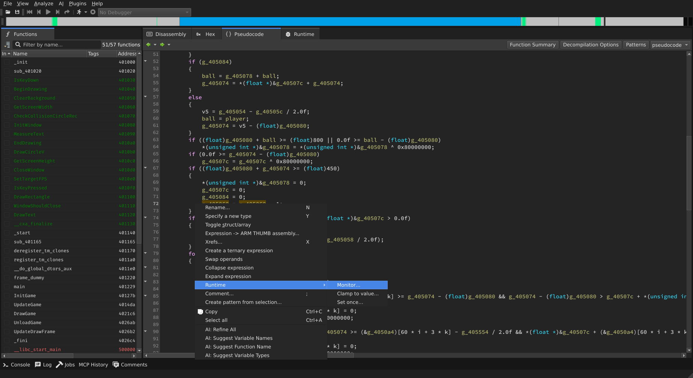
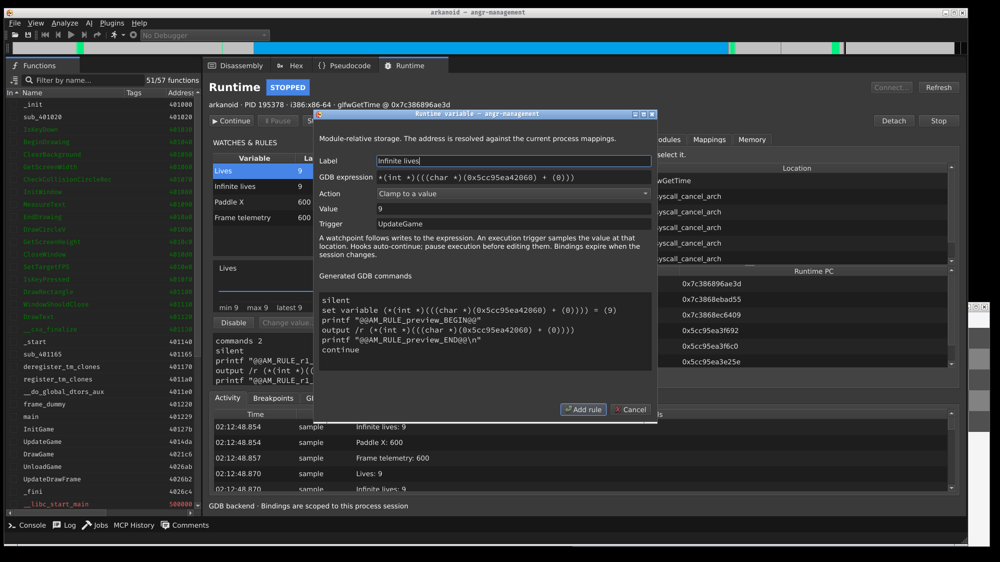
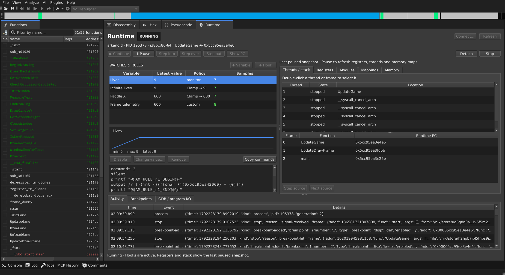
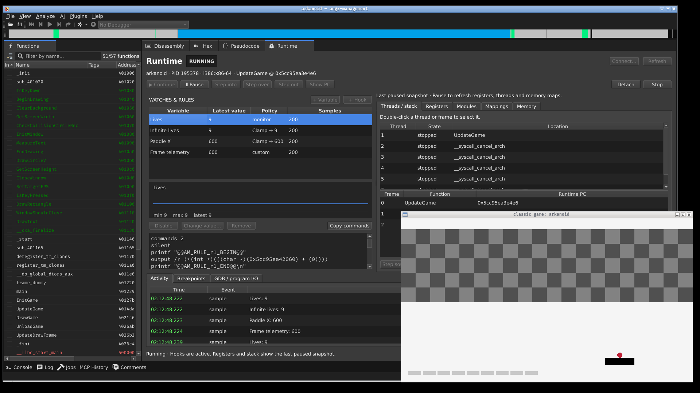

Live runtime debugger
=====================

The Runtime Debugger controls the program you are analyzing through GDB. Open it
from **View → Runtime Debugger**, or choose **Live process (GDB)** in the debug
toolbar's launch menu. The GUI and ``runtime_*`` MCP tools share one session.

Connect and inspect
-------------------

Install GDB separately and select its executable in the connection dialog.
**Launch** accepts an executable, arguments, working directory and environment;
**Attach** connects to a local PID; **Remote** connects to a gdbserver endpoint.
Attaching requires the host's usual debugger permissions. Local launch requires
POSIX pseudo-terminal (PTY) support.

A launch stops at the first instruction by default, including for stripped
executables. Set an execution breakpoint at ``main`` or another function and
continue to reach application code. GDB does not disable ASLR.

Use the execution bar to continue, pause, step into or over an instruction,
finish the current frame, detach, or stop the target. **Detach** releases the
process; **Stop** terminates it. Source stepping is available in **Threads /
stack** when debug information is present. Double-click a thread or frame to
select it. Double-click a register to edit it. The memory inspector reads runtime
addresses or GDB address expressions and can write bytes to the live process.

Inspection requires a stopped target. While it runs, the panel retains the last
stopped values and updates hook samples and output. Program input is available
for locally launched targets through a separate terminal.

From pseudocode to a live variable
----------------------------------

Right-click a variable in the decompiler and choose **Runtime → Monitor**,
**Clamp to value**, or **Set once**. The dialog shows the resolved expression,
its scope, and the GDB commands that will run. You can edit the expression or
enter one manually, such as ``player.life``, ``*(unsigned int *)0x12340000``, or
``$rax``. Debug-symbol names work when GDB knows them; decompiler renames do not
automatically create debugger symbols.

Global storage uses the current module mapping. Scalar fields and constant
array indices retain their offsets. Recovered stack locations use the stack
map at the selected instruction and an execution breakpoint there; the address
is recomputed on each invocation. These hooks run before their instruction: a
clamp writes at that point, and a later instruction can overwrite it. Choose a
trigger where the value is consumed when changing a local's behavior.
Recovered register names do not prove where an optimized variable is live.
Register variables, optimized temporaries, ambiguous
stack locations and unsupported pointer expressions require a manual binding.

**Monitor** records values and continues execution. **Clamp** writes the chosen
value on each trigger and then continues. With an empty trigger, the rule uses a
write watchpoint; a function or ``*0xADDRESS`` trigger uses an execution
breakpoint. A watchpoint fires after a write, so this is not an atomic constraint
on all observers in a multithreaded program. Hardware watchpoint slots and
supported sizes depend on the target. GDB reports an error when a rule cannot
be installed.

Select a rule to see its recent samples, numeric history and generated commands.
Pause to change a clamp value, disable a rule, or remove it. **Set once** writes
immediately; an inferred local binding requires the selected frame to be at its
scoped instruction. Rules and raw addresses expire on reconnect. Applying a
dialog from an older process session is rejected.

Custom hooks
------------

Choose **Hook** to install your own GDB breakpoint commands, or use the GDB
console's script editor for multi-line scripts. Custom commands run in GDB and
can change the process and debugger. For example, an execution trigger at
``UpdateGame`` can run::

    set variable player.life = 9
    set variable ball.speed.x = 3

Rules at the same execution address share a breakpoint: all enabled actions run
before one automatic continue. Omit ``continue`` from custom commands to let
them compose with other rules. An explicit resume command is accepted only for
a rule running alone. A managed stopping breakpoint cannot share an enabled
hook's location; disable one before installing the other.

Use the connection dialog or MCP lifecycle tools to launch, attach, reconnect
or change the executable. The console rejects direct lifecycle commands so
cached mappings and rules cannot silently follow a different process. Custom
Python scripts remain trusted debugger code, and can alter GDB outside these
managed controls.

Sample history and console output are bounded. Frequent breakpoints still slow
the target down.

Addresses and module identity
-----------------------------

The **Modules** inspector shows actual mapped ranges and ELF load bias. Local
Linux mapping uses the process's device/inode identity and matches file offsets
to ELF load segments, including split permissions and anonymous BSS tails.
Translation checks the selected module and rejects unmapped addresses rather
than assuming that the first executable mapping is the binary's base.

**Show PC** translates the selected frame's runtime address back into the
analyzed executable. For another loaded module, select it and specify the base
at which your analysis loaded that module. Unknown, replaced, or ambiguous
module mappings produce an error. Available build IDs are checked against the
live image and against the analyzed module. Automatic relocation requires a
local Linux ELF target. Remote debugging supports GDB control and expressions;
automatic address relocation is unavailable for remote targets.

MCP
---

Start the embedded server as described in :doc:`mcp_server`. Runtime tools
control the same process and rules as the GUI:

* ``runtime_launch``, ``runtime_attach``, ``runtime_connect_remote`` and
  ``runtime_control`` manage execution and session lifetime. ``runtime_configure``
  selects the GDB executable while disconnected.
* ``runtime_status`` reports state, capabilities, modules, threads, frames,
  registers, breakpoints, rules and recent events. ``runtime_select`` changes
  the selected thread/frame.
* ``runtime_evaluate``, ``runtime_memory``, ``runtime_write_register`` and
  ``runtime_map_address`` inspect or edit live state.
* ``runtime_breakpoint``, ``runtime_add_rule`` and ``runtime_update_rule``
  manage breakpoints and hooks. ``runtime_add_rule(preview=True)`` returns the
  generated commands without installing them.
* ``runtime_list_variables`` lists selections in a cached decompilation;
  ``runtime_bind_variable`` resolves a selection and previews or installs its
  rule through the same binding code as the context menu.
* ``runtime_console`` runs user GDB commands and scripts;
  ``runtime_send_input`` sends input to the launched program.

These tools can execute programs and modify their live state. The MCP server's
authentication and access controls apply to them as well as to analysis tools.

Game walkthrough
----------------

This example uses `Arkanoid from raylib-games
<https://github.com/raysan5/raylib-games/blob/318688c759eaf391b36b9f893355c038fcf56419/classics/src/arkanoid.c>`_.
Load and launch the executable, then stop at ``UpdateGame`` after initialization.
Select the recovered lives variable in pseudocode and choose **Runtime → Monitor**.
The dialog resolves its storage against the live module. Set ``UpdateGame`` as
the trigger to sample each frame.

Choose **Clamp to value**, enter ``9``, and use the same trigger. The generated
GDB commands are visible before installation.

The running panel records the change from five lives to nine. This session also
clamps ``player.position.x`` to ``600`` and runs a custom hook at ``DrawGame``.

Backend development
--------------------

``logic/debugger/gdb`` is independent of Qt. It serializes GDB commands and
publishes state, output and sample events. Consumers schedule commands off the
GUI thread and marshal events back to it. A snapshot is a detached copy of the
session's state; it is not an angr symbolic state. The runtime panel and MCP
tools consume this service.

Generated monitor/clamp hooks use GDB breakpoint command lists. They do not
perform writes from a Python ``Breakpoint.stop`` callback.

The focused tests use the public 2048 fixtures in
``angr/binaries/tests/x86_64/runtime_2048``. The game sources, licenses, build
recipe and binaries are kept together there; tests do not compile their inputs.
